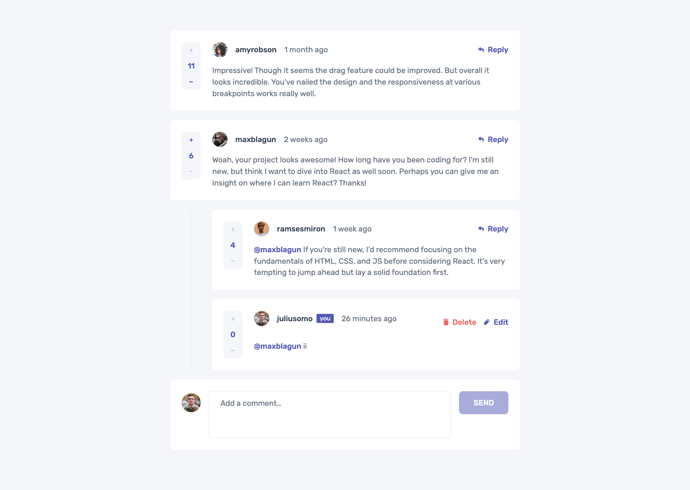
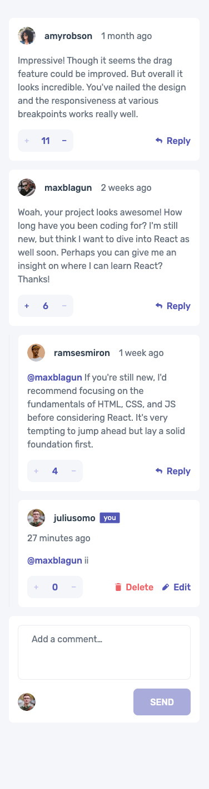
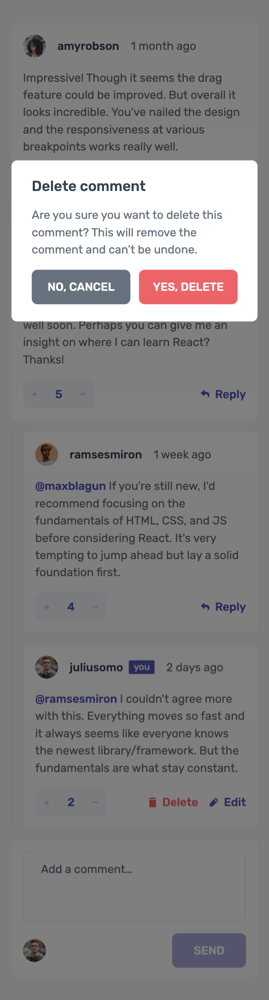

# Frontend Mentor - Interactive comments section solution

This is a solution to the [Interactive comments section challenge on Frontend Mentor](https://www.frontendmentor.io/challenges/interactive-comments-section-iG1RugEG9). Frontend Mentor challenges help you improve your coding skills by building realistic projects.

## Table of contents

- [Overview](#overview)
  - [The challenge](#the-challenge)
  - [Expected behaviour](#expected-behaviour)
  - [Screenshots](#screenshots)
  - [Links](#links)
- [My process](#my-process)
  - [Built with](#built-with)
  - [How it works](#how-it-works)
  - [What I learned](#what-i-learned)
  - [Useful resources](#useful-resources)
  - [AI Collaboration](#ai-collaboration)
- [Author](#author)

## Overview

### The challenge

Users should be able to:

- View the optimal layout for the app depending on their device's screen size
- See hover states for all interactive elements on the page
- Create, Read, Update, and Delete comments and replies
- Upvote and downvote comments
- **Bonus**: Use `localStorage` to save the current state in the browser so that it persists when the browser is refreshed
- **Bonus**: Use timestamps instead of the `createdAt` strings from `data.json` and track the time since each comment or reply was posted

### Expected behaviour

- First-level comments are ordered by their score, whereas nested replies are ordered by time added.
- Replying to a comment adds the new reply to the bottom of the nested replies within that comment.
- A confirmation modal pops up before a comment or reply is deleted.
- Adding a new comment or reply uses the `currentUser` object from `data.json`.
- You can only edit or delete your own comments and replies.

This solution also makes some choices that the brief leaves open:

- **Votes**: one vote per entry. Pressing the active vote removes it, the other arrow replaces it, and your own entries can't be voted on.
- **Replies to replies** stay in the same thread. The recipient appears above the editor, outside the text you can type or select.
- **Forms**: only one reply or edit form is open at a time. Escape closes it and focus goes back to the button that opened it.
- **Content**: empty comments can't be sent. A counter appears in the last 100 of the 1000 allowed characters and announces changes after a pause.
- **Deleting** a comment also removes its replies. Cancelling keeps everything as it was, including an open edit.
- **Time**: labels such as "2 weeks ago" refresh every minute, and the exact date shows on hover.

### Screenshots





### Links

- Solution URL: [GitHub Repository](https://github.com/FerdinandoGeografo/interactive-comments-section)
- Live Site URL: [Interactive comments section](https://interactive-comments-section-fg.vercel.app/)

## My process

### Built with

- Semantic HTML5 markup
- Mobile-first workflow with Flexbox and CSS Grid
- [React (v19)](https://react.dev/) - JS library, with the [React Compiler](https://react.dev/learn/react-compiler)
- [TypeScript](https://www.typescriptlang.org/) - JS superset
- [Vite](https://vite.dev/) - Frontend build tool
- [Tailwind CSS (v4)](https://tailwindcss.com/) - For styles, with the palette in `src/index.css`
- [Base UI](https://base-ui.com/) - Accessible primitives, through local [shadcn/ui](https://ui.shadcn.com/) wrappers (button, textarea, alert dialog)
- [class-variance-authority](https://cva.style/) - Button variants
- [Motion](https://motion.dev/) - Entry, exit and layout animations

### How it works

- **State**: one reducer (`src/contexts/commentsReducer.ts`) behind a context and custom hooks. Drafts and the delete dialog stay local to their components. The open reply or edit form lives in its own context, so opening one closes the other.
- **Model**: entries are a discriminated union. A reply knows its thread and who it answers, and it never has replies of its own:

  ```ts
  export type CommentTarget =
    | { kind: "comment"; id: string }
    | { kind: "reply"; threadId: string; id: string };
  ```

- **Rules in the reducer**: IDs and timestamps come from the caller, while author, score and vote are set by the reducer. An action that breaks a rule (editing someone else's reply, voting on your own comment, empty content) returns the previous state.
- **Ordering**: roots are sorted only for display, so ties keep their original order: `comments.toSorted((a, b) => b.score - a.score)`.
- **Persistence**: the first visit saves the data from `data.json`, and every change is saved after it. Before stored data is used, a structural check confirms the fields the page reads: the current user, and for every comment and reply its id, content, valid date, score, vote and author. Missing, invalid, outdated or incomplete data starts again from the original data, while a valid empty list stays empty:

  ```ts
  const stored = JSON.parse(localStorage.getItem(STORAGE_KEY) ?? "null");
  if (stored?.version === STORAGE_VERSION && isCommentsState(stored.state))
    return stored.state;
  ```

- **Time**: the seed labels become ISO timestamps on the first load. A single shared clock ticks every minute and `Intl.RelativeTimeFormat` formats the labels, so a 9-day-old reply reads "1 week ago".

### What I learned

#### Keeping the recipient out of the editor

Reply and reply-edit forms show “Replying to @username” above the textarea and link it to the field's accessible description. The textarea value is only the comment content. Selection, Backspace, paste and undo work on that value without special prefix handling. The recipient remains in `replyingTo`, and published replies still show their mention:

```tsx
<p id={recipientId}>Replying to @{replyingTo}</p>
<Textarea value={content} aria-describedby={`${recipientId} ${counterId}`} />
```

#### Votes as a small state machine

Each entry stores the current user's vote (`-1`, `0` or `1`). The score is updated from the difference, so switching from upvote to downvote moves it by two:

```ts
const vote = nextVote(entry.currentUserVote, direction); // same arrow → 0
const score = entry.score - entry.currentUserVote + vote;
```

#### Animating content that is leaving

With `AnimatePresence` a deleted comment or a closing form stays in the DOM while it fades out. `useIsPresent` makes it `inert`, so it can't be focused or submitted twice. During layout animations the sliding siblings could also cover a form that just opened, and `focus-within:z-10` keeps the focused entry on top:

```tsx
const isPresent = useIsPresent();

return (
  <motion.li
    layout="position"
    inert={!isPresent}
    className="relative focus-within:z-10"
  >
    <article>{/* header, content, score, actions */}</article>
  </motion.li>
);
```

#### Focus after deleting

The delete button disappears with its comment, so focus can't return to it. When the deletion is confirmed, the dialog's `finalFocus` returns Reply or Edit on the next entry in the same list, or the previous one, instead of the trigger. A lone reply uses its parent comment; an empty list uses “Add a comment”. Cancel and Escape return focus to the Delete button.

```tsx
<AlertDialogContent
  finalFocus={() => (isConfirmedRef.current ? getFocusAfterConfirm() : true)}
/>
```

#### Feedback without breaking announcements

The score pulses after each vote, but it is also an `aria-live` region. Remounting it would change what screen readers announce, so the pulse switches between two identical variants instead:

```tsx
<motion.span
  aria-live="polite"
  variants={scoreVariants}
  animate={votes % 2 === 0 ? "even" : "odd"}
>
  {score}
</motion.span>
```

### Useful resources

- [Scaling up with reducer and context](https://react.dev/learn/scaling-up-with-reducer-and-context) - The state structure.
- [Base UI Alert Dialog](https://base-ui.com/react/components/alert-dialog) - Initial and final focus, `onOpenChangeComplete`.
- [Base UI: animation](https://base-ui.com/react/handbook/animation) - CSS transitions with `data-starting-style` and `data-ending-style`.
- [Motion: AnimatePresence](https://motion.dev/docs/react-animate-presence) and [layout animations](https://motion.dev/docs/react-layout-animations) - Exits, `popLayout` and reordering.
- [Intl.RelativeTimeFormat](https://developer.mozilla.org/en-US/docs/Web/JavaScript/Reference/Global_Objects/Intl/RelativeTimeFormat) - The relative time labels.
- [inert](https://developer.mozilla.org/en-US/docs/Web/HTML/Global_attributes/inert) - Keeping exiting content out of reach.

### AI Collaboration

I used Claude, through Claude Code, as a pair reviewer, while keeping the decisions and the testing on my side.

- **Planning first**: every block (UI primitives, domain rules, persistence and time, layout review, animations) started from an audit of the code and a plan I approved, and closed with small commits.
- **Decisions**: the open points of the brief (vote policy, replies to replies, content limit, what deleting a thread removes) were listed as questions, and I chose each answer.
- **Context in local files**: an `AGENTS.md` with the working rules, and notes on the architecture, the open decisions and the acceptance criteria.

## Author

- Frontend Mentor - [@FerdinandoGeografo](https://www.frontendmentor.io/profile/FerdinandoGeografo)
- LinkedIn - [@FerdinandoGeografo](https://www.linkedin.com/in/ferdinandogeografo/)
- GitHub - [@FerdinandoGeografo](https://github.com/FerdinandoGeografo/)
